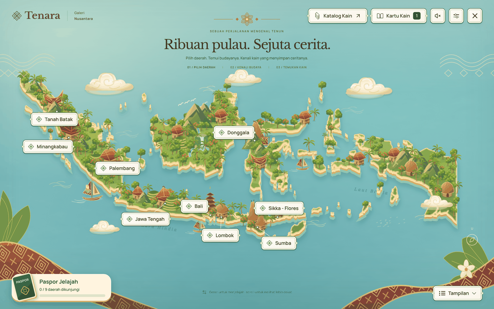
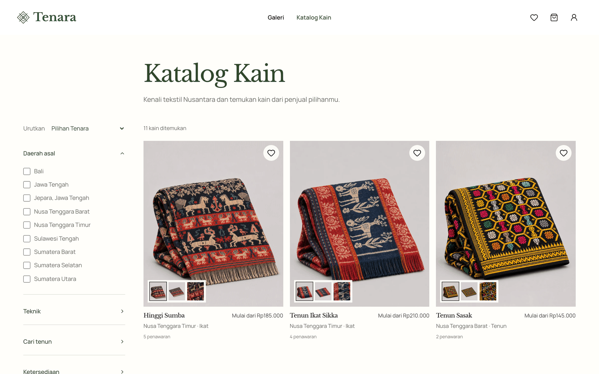
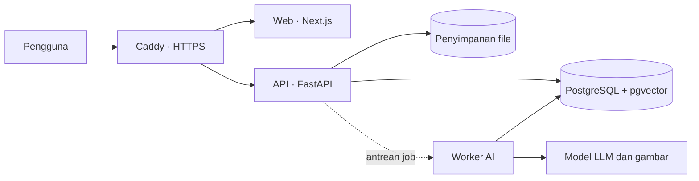
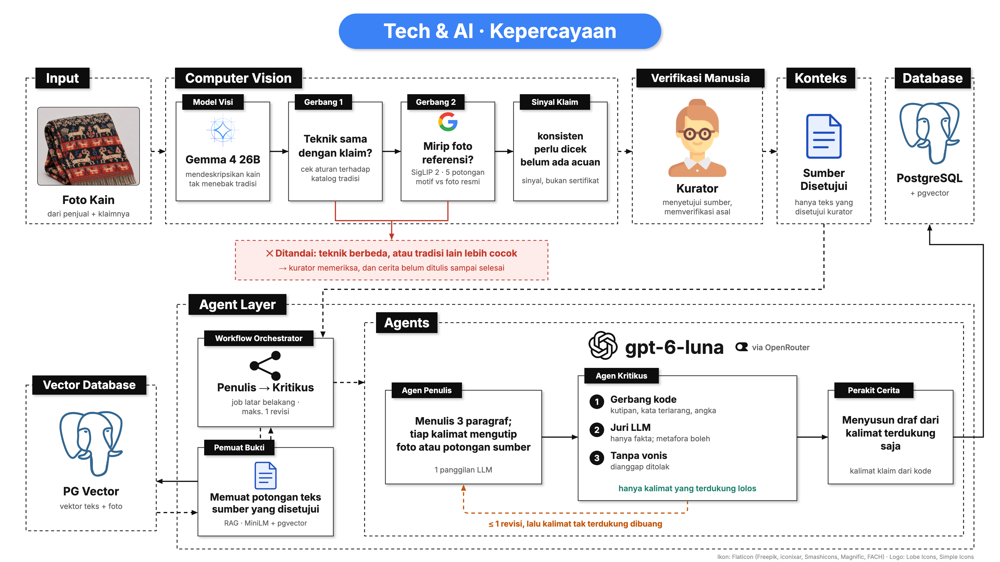
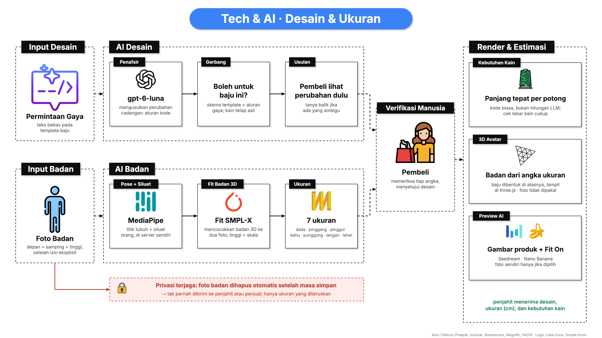

# Tenara

Marketplace tenun Nusantara: kenali budayanya, beli kainnya, jahit bajunya.

<p align="center">
  
  
</p>

**Live:** https://tenara-demo-c8kf.eastasia.cloudapp.azure.com

## Produk

Tenara menyatukan tiga hal dalam satu alur: **belajar** (galeri budaya interaktif), **belanja** (katalog kain dari penjual), dan **menjahit** (baju custom dari kain yang dipilih).

| Peran | Yang bisa dilakukan |
|---|---|
| Pembeli | Jelajah peta budaya, beli kain per meter atau potong, rancang baju custom (pola, gaya lewat teks, ukuran dari foto, preview 3D dan AI), pilih penjahit, chat, ajukan klaim |
| Penjual | Unggah kain, scan foto oleh AI, cerita budaya bersumber, kelola stok dan pesanan |
| Penjahit | Terima permintaan custom, validasi desain, terbitkan penawaran, produksi dan kirim |
| Kurator | Kelola galeri dan sumber budaya, verifikasi mitra dan asal kain, putus banding |

## Arsitektur



Proses berat (ukur badan, preview, cerita) jalan di worker lewat antrean Postgres, bukan di request.

## Tech & AI

AI di Tenara membantu, bukan memutuskan: tiap keluaran dicek aturan kode atau manusia sebelum sampai ke pengguna.

**Kepercayaan.** Foto kain dideskripsikan model visi, dicek terhadap katalog dan foto referensi kurator, lalu ditulis menjadi cerita yang tiap kalimatnya bersumber.



**Desain & ukuran.** Teks gaya dan dua foto badan menjadi desain tervalidasi, ukuran jahit dari model badan 3D, estimasi kain, dan preview.



| Komponen | Model |
|---|---|
| Penulis dan kritikus cerita, penafsir desain | `openai/gpt-6-luna` via OpenRouter |
| Deskripsi foto kain | Gemma 4 26B |
| Cek foto terhadap referensi | SigLIP 2 (lokal, ONNX) |
| Pencarian dan RAG | `paraphrase-multilingual-MiniLM-L12-v2` + pgvector |
| Ukur badan | MediaPipe Pose + SMPL-X (PyTorch, lokal) |
| Gambar produk dan Fit On | Seedream atau Nano Banana |

## Stack

| Lapisan | Teknologi |
|---|---|
| Web | Next.js 16, React 19, Tailwind 4, three.js |
| API | FastAPI, SQLAlchemy 2, Alembic, Pydantic |
| Data | PostgreSQL 17 + pgvector |
| Infra | Docker Compose, Caddy (HTTPS otomatis), GitHub Actions |

## Jalankan lokal

Prasyarat: Docker Compose, [uv](https://docs.astral.sh/uv/), Python 3.12+, Node.js 20.9+.

```bash
cp .env.example .env              # isi key OpenRouter untuk fitur AI
docker compose up -d db

cd services/api
uv sync --locked
uv run alembic upgrade head
DEMO_PASSWORD=demo-pass-123 uv run python -m scripts.seed_demo
uv run python -m scripts.seed_catalog
uv run uvicorn app.main:app --port 8000      # API
uv run python worker.py                      # terminal lain: worker

cd ../../web && npm ci && npm run dev        # http://localhost:3000
```

Swagger di `http://localhost:8000/docs`. Akun contoh: `buyer@tenara.demo`, `merchant-sumba@tenara.demo`, `tailor-bandung@tenara.demo`, `admin@tenara.demo`.

Mau database dan file yang sudah terisi? Pakai [snapshot portabel](docs/PORTABLE.md).

## Deploy produksi

```bash
export COMPOSE_FILE=docker-compose.yml:docker-compose.prod.yml
docker compose up -d --build      # db, api (migrasi otomatis), worker, web, caddy
```

`.env` wajib berisi `DB_PASSWORD`, `JWT_SECRET`, `FILE_URL_SECRET`, `SITE_ADDRESS`, `NEXT_PUBLIC_API_URL`, dan key LLM. CI/CD di `.github/workflows/ci-cd.yml`: tes, lint, build, lalu deploy lewat `scripts/deploy-vm.sh` dengan backup database sebelum rilis.

## Kualitas dan keamanan

- 500+ tes API, `ruff`, `tsc`, dan `next build` di CI.
- Password argon2, JWT 12 jam, URL file privat bertanda tangan dan kedaluwarsa 5 menit.
- Optimistic locking dan `Idempotency-Key` untuk aksi uang.
- Foto badan privat, dihapus otomatis setelah masa simpan, dan tidak pernah dikirim ke penjahit atau penjual. Metadata EXIF/GPS dibuang saat unggah.
- Tiap peran hanya menerima data yang menjadi bagiannya; filter dilakukan di API.

## Dokumentasi

- [Kontrak API dan alur bisnis](docs/HANDOFF.md)
- [Snapshot portabel](docs/PORTABLE.md)
- Sumber diagram (HTML): [`docs/diagrams`](docs/diagrams)

## Kredit

Ikon: [Flaticon](https://www.flaticon.com) oleh Freepik, iconixar, Smashicons, Magnific, dan FACH. Logo: [Lobe Icons](https://lobehub.com/icons) dan [Simple Icons](https://simpleicons.org).
